<b>Bartosz Zambrzycki</b> · Junior Fullstack developer

- **Frontend:** Angular, TypeScript
- **Backend:** C#, .NET
- **Storage:** SQL, Object Storage (S3)
- **System:** Linux
- **Delivery:** Git, CI/CD, Docker
- **Scripting:** Bash, Python

Reach me through [bobbyos.dev](https://bobbyos.dev) or e-mail bartoszzambrzycki@proton.me.

